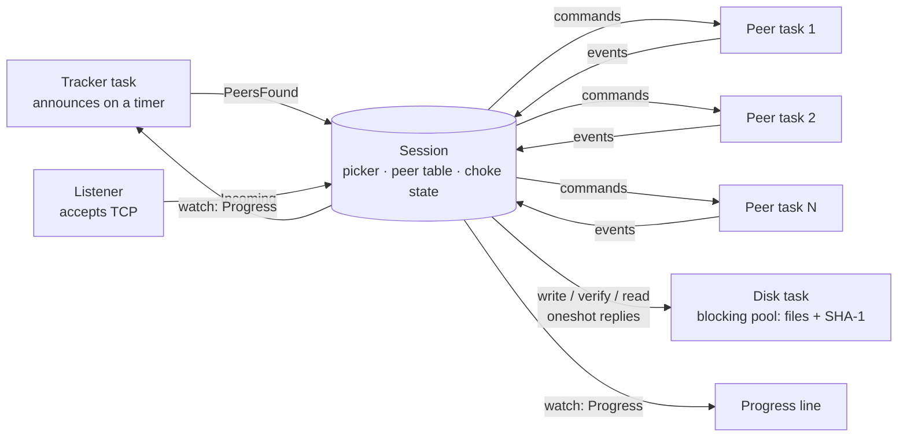

# Oxtorrent

A command-line BitTorrent client written in Rust. It downloads a file from many peers at once, checks every piece with SHA-1 and shares the file back.

It also ships a **swarm simulator**. The simulator runs the client's real piece-selection and choking code against hundreds of simulated peers and measures which strategies work best (see [Swarm simulator](#swarm-simulator)).

Everything BitTorrent-specific is written by hand: the bencode parser, the wire codec, the piece picker and the choking logic. Crates cover only networking, hashing and plumbing.

> **Legal use.** Test only with content you are free to share, such as Linux distribution images and public-domain items from the Internet Archive.

## Usage

```bash
cargo build --release

# Inspect a torrent
target/release/oxtorrent info debian.iso.torrent

# Download it
target/release/oxtorrent download debian.iso.torrent --output ~/Downloads

# Keep seeding afterwards, until Ctrl-C
target/release/oxtorrent download debian.iso.torrent --output ~/Downloads --seed

# Or start from a magnet link (quote it: it contains &)
target/release/oxtorrent download "magnet:?xt=urn:btih:7acf8fb590b2060dd9c3146ef770169d593433b0&tr=udp%3A%2F%2Ftracker.opentrackr.org%3A1337%2Fannounce" --output ~/Downloads

# Several at once, files and magnet links mixed
target/release/oxtorrent download debian.iso.torrent ubuntu.iso.torrent "magnet:?xt=urn:btih:..." --output ~/Downloads
```

Several torrents in one `download` run at the same time and share one TCP port, one DHT node and one peer ID. The listener reads each incoming handshake and hands the connection to the torrent it names, so other peers reach every torrent on the same port; connections for a torrent not in the run are closed. Each torrent otherwise has its own session (picker, choker, peers, tracker), and `--max-peers` is split evenly between them. Naming the same torrent twice is an error.

With a magnet link, the client first fetches the torrent's info dictionary from peers (BEP 9), checks its SHA-1 against the link's info hash and saves it as `<name>.torrent` in the output folder. Running `download` on that file later resumes without fetching the metadata again. The link's `xt` (hex or base32 info hash), `tr` (trackers), `dn` (name) and `x.pe` (peers) fields are read.

| Option | Default | Meaning |
|---|---|---|
| `--output <dir>` | current folder | Where to save the files |
| `--port <n>` | 6881 | TCP port for incoming peers |
| `--max-peers <n>` | 50 | Maximum simultaneous connections, incoming and outgoing together, shared evenly between torrents |
| `--seed` | off | Keep uploading after the download completes |
| `--pipeline <n>` | 5 | Minimum outstanding block requests per peer; each peer's queue grows to about 3 s of its measured rate (up to 128 blocks) |
| `--peer <ip:port>` | none | Extra peer to dial for every torrent; may be repeated (useful on a LAN) |
| `--no-dht` | DHT on | Find peers only through trackers and `--peer`. The DHT uses UDP on the same port number as `--port`, and is never used for private torrents (BEP 27). |
| `--dashboard` | off | Full-screen view instead of the status line (see below). Ignored when standard output is not a terminal. |
| `-v`, `-vv`, `-vvv` | off | Info, debug or trace logs on standard error |

- `download` prints one status line per second on standard output: percent done, download and upload speed, connected peers and time left. Logs go to standard error, so the status line stays clean.
- `--dashboard` redraws the whole terminal once a second: a progress bar with time left, download and upload rates, a speed sparkline for the last 60 s, a two-row map of the pieces (verified, mostly done, started, missing), and a table of peers sorted by download speed with their client, rates, flags, outstanding requests and share of pieces. The flags are `D` downloading from it, `d` interested but choked by it, `U` uploading to it, `u` it is interested but we choke it. The normal screen comes back when the download ends or on Ctrl-C.
- With several torrents, a terminal shows one combined line (`1/3 done` and the totals); a file or pipe gets one line per torrent each second, prefixed with its name. `--dashboard` adds a row per torrent above a peer table covering all of them.
- Ctrl-C shuts down cleanly. The client tells the tracker it has stopped, closes the connections and flushes the files. A second Ctrl-C exits at once.
- Exit code `0` means every download completed and every piece verified. Code `2` means one was interrupted, and running the same command again resumes it. Code `1` means an error in any of them, with the reason printed to standard error. With several torrents, the final report has one line per torrent.
- Resuming re-hashes whatever is already on disk and keeps the pieces that match, so it is correct even after a crash.

## Architecture

The client is a set of independent async tasks that only exchange messages. One coordinator task owns all download state, so no locks guard it.



| Task | Count | Owns | Job |
|---|---|---|---|
| Session | 1 | piece picker, peer table, choke state | Decides which peer downloads which block, and who gets uploads |
| Peer | 1 per connection | one TCP socket | Handshake, framing, validation, reports events |
| Tracker | 1 | tracker URLs, timers | `started` / periodic / `completed` / `stopped` announces, with retry back-off (15 s doubling up to 30 min) |
| Listener | 1 | listening socket | Hands each incoming connection to the session, which enforces `--max-peers` |
| Disk | 1 | files, piece buffers | Buffers blocks, hashes pieces, writes only verified data, reads blocks for upload |
| Progress | 1 | terminal | Prints the status line once a second |

All channels are bounded. The session never waits on a peer: it uses `try_send`, and a peer whose queue is full gets disconnected. A slow disk does slow the session down, which in turn slows the downloads, so memory stays flat.

### Modules

| Module | Responsibility |
|---|---|
| [`bencode`](src/bencode.rs) | Parse and write bencode. It records the byte span of the top-level values, so the info hash is taken over the original bytes. |
| [`metainfo`](src/metainfo.rs) | Typed `Torrent`, info hash, piece and block size arithmetic, path safety checks |
| [`tracker`](src/tracker.rs) | HTTP announces (URL building, reply parsing in compact, dictionary and IPv6 forms), [UDP announces](src/tracker/udp.rs) (BEP 15: connect / announce, cached connection IDs, retransmission at 3, 6 and 12 s), and the tracker task |
| [`peer::handshake`](src/peer/handshake.rs) | The 68-byte opening exchange |
| [`peer::message`](src/peer/message.rs) | `Message` enum and the `tokio_util` codec, with a hard size cap |
| [`peer::extension`](src/peer/extension.rs) | Extension protocol (BEP 10): reserved bit, extended handshake, `ut_metadata` messages (BEP 9) |
| [`peer::connection`](src/peer/connection.rs) | The per-peer task: timeouts, keep-alives, batching of outgoing messages; answers metadata requests from other peers |
| [`magnet`](src/magnet.rs) | Magnet link parsing and fetching the info dictionary from peers |
| [`dht`](src/dht/mod.rs) | Mainline DHT node (BEP 5): [KRPC messages](src/dht/krpc.rs), [routing table](src/dht/routing.rs), iterative lookups, announce tokens, peer store |
| [`picker`](src/picker.rs) | Rarest first, partial pieces first, pipelining, block timeouts, endgame (at most 2 peers per block, oldest requests first). Pure logic. |
| [`choke`](src/choke.rs) | Tit-for-tat with a rotating optimistic slot. Pure logic. |
| [`disk`](src/disk.rs) | Multi-file layout, verified-only writes, resume, bad-block attribution |
| [`session`](src/session.rs) | The coordinator loop |
| [`sim`](src/sim/mod.rs) | Discrete-event swarm simulator |
| [`cli`](src/cli.rs) | Arguments and the progress line |
| [`router`](src/router.rs) | The shared listener: reads each incoming handshake and passes the connection to the session for that info hash |
| [`dashboard`](src/dashboard.rs) | The `--dashboard` view. Rendering is plain text from a progress snapshot, so it is tested without a terminal; `crossterm` only draws it. |

### Design notes

- **Message passing, not shared locks.** Exactly one task changes piece state. That rules out lock-ordering bugs and data races, and the coordinator handling events one at a time is fine at 50 to 200 peers.
- **Whole pieces are buffered in memory.** A piece is hashed before it is written, so unverified data never reaches the output file. The number of pieces in progress is capped by memory: 64 MiB of piece buffers (16 pieces at 4 MiB, 256 at 256 KiB), with a floor of 16 pieces.
- **Hashing runs off the async threads.** The disk task runs on Tokio's blocking pool, so SHA-1 never stalls the threads that drive sockets.
- **Bad-data attribution.** When a piece fails its hash check, the disk task records a hash of each block and who sent it. If one peer sent the whole piece, that peer gets a strike straight away. Otherwise strikes wait until a good copy verifies, and then go only to peers whose blocks differ from it. A peer with 3 strikes is banned. An honest peer that shared a piece with a corrupt one is never punished.

### Untrusted input checks

- Message length is capped at a full block message or the bitfield size, whichever is bigger. A peer that claims a 2 GB message is dropped before anything is allocated.
- Requests above 16 KiB close the connection. Piece indexes and offsets are checked against the real sizes.
- A bitfield must have the exact length and zero spare bits.
- Every path component is checked: empty parts, `.`, `..`, separators and NUL are rejected, and so is `:` on Windows. Bencode nesting is capped at 64 levels.
- Timeouts: 10 s to connect, 10 s for the handshake, 30 s per requested block, 150 s of silence. A peer that keeps us choked for 90 s while we want its pieces is also dropped.
- The crate has `#![forbid(unsafe_code)]`. Clippy denies `unwrap()` and `expect()` outside tests.

## Testing

```bash
cargo test
```

| Layer | What |
|---|---|
| Unit tests | Bencode (the spec examples, nesting, malformed input), info hash of a known torrent, codec round trips and split reads, picker (rarest, partial-first, choke/timeout release, endgame), choke (top 3 plus a rotating optimistic slot), disk (last-piece sizes, pieces that cross file boundaries, resume) |
| Property tests | `proptest`: decode(encode(v)) == v, and random bytes never make the bencode parser or the message codec panic |
| Integration tests | A [fake tracker](tests/common/fake_tracker.rs) and a [fake peer](tests/common/fake_peer.rs) on localhost, with no internet needed |
| Live tests | By hand, before a milestone is marked done (see below) |

Fake peer behaviours ([`tests/bad_peers.rs`](tests/bad_peers.rs), [`tests/download.rs`](tests/download.rs)):

| Behaviour | Expected result |
|---|---|
| Honest seeder | A 1 MB file downloads byte for byte. Running again resumes with nothing fetched. |
| Sends one corrupt block | That piece is re-downloaded and the file is still correct |
| Always sends corrupt data (alongside an honest peer) | It is banned, the honest peer is not, and it is never dialled again |
| Disconnects mid-piece | Its blocks go to another peer |
| Never unchokes | Dropped after the choke timeout, and shutdown completes within 3 s |
| Sends an oversized length prefix | The connection closes and nothing is downloaded |

[`tests/seeding.rs`](tests/seeding.rs) runs two copies of the client: one seeds, the other downloads from it. That covers the upload path. CI ([`.github/workflows/ci.yml`](.github/workflows/ci.yml)) runs `cargo fmt --check`, `cargo clippy --all-targets -- -D warnings` and `cargo test` on every push.

### Live tests (by hand)

**Result, 2026-11-16:** `debian-13.7.0-amd64-netinst.iso` (756 MiB, 3024 pieces) downloaded from the public swarm via `bttracker.debian.org`. The file's SHA-256 (`a7ef94ac…e355`) matched Debian's `SHA256SUMS`.

| Measure | Value |
|---|---|
| Total time | 226 s, about 3.3 MiB/s on average and 4.2 MiB/s at the end, on a home connection |
| Peers | 50 from the tracker; 14 to 18 connected |
| Time to first verified piece | About 4 s (target under 10 s) |
| Peak memory | 15.7 MB |
| Failed pieces | 0. 758.6 MiB was received for a 756 MiB file; the extra 2.6 MiB is endgame duplicates. |
| Exit code | 0 |

**Comparison with Transmission 4.1.3, 2026-11-16.** Same torrent and network, runs alternating Transmission, Oxtorrent, three rounds, each from an empty folder. Transmission ran as `transmission-daemon` with DHT, PEX, LPD and uTP off and 50 peers per torrent, so both clients found peers only through the tracker. All six outputs matched Debian's SHA-256.

| | Run 1 | Run 2 | Run 3 | Average | Peak memory |
|---|---|---|---|---|---|
| Transmission | 157.4 s | 112.9 s | 117.2 s | 129.2 s (5.85 MiB/s) | ~35 MB |
| Oxtorrent | 247.6 s | 243.9 s | 145.9 s | 212.5 s (3.56 MiB/s) | ~15.6 MB |

That puts Oxtorrent at **61%** of Transmission's speed, short of the 80% target. Likely causes, in the order to check them: a fixed pipeline of 5 requests per peer (Transmission sizes its queue from each peer's rate), fewer connected peers (14 to 18 of the 50 returned), and unproductive peers that are dropped only after 90 s.

Since then the first cause has been addressed: each peer's request queue now follows its smoothed download rate (about 3 s of data, 5 to 128 blocks), and the in-progress cap is set by memory rather than a fixed 16 pieces, which with 256 KiB pieces had allowed only 256 blocks in flight across the whole swarm. A re-run on 2026-11-16 was abandoned because Debian's tracker stopped accepting connections partway through.

**Re-run after the queue fix, 2026-11-17.** Debian's tracker was still down, so both clients got the same image through `udp://tracker.opentrackr.org:1337/announce`. The `.torrent` was rebuilt with that as its only tracker: same info hash, no web seeds. Otherwise the setup was the same as above: alternating runs, three rounds, Transmission's DHT, PEX, LPD and uTP off, and no DHT in the Oxtorrent build. All six outputs matched Debian's SHA-256.

| | Run 1 | Run 2 | Run 3 | Average | Peak memory |
|---|---|---|---|---|---|
| Transmission | 110.1 s | 111.1 s | 196.3 s | 139.2 s (5.43 MiB/s) | ~30 MB |
| Oxtorrent | 103.7 s | 121.3 s | 160.0 s | 128.3 s (5.89 MiB/s) | ~60 MB |

Oxtorrent now averages **108%** of Transmission's speed, ahead in rounds 1 and 3 and at 92% in round 2. The swarm's speed changed between rounds (round 3 was slow for both), which is why runs alternate. Oxtorrent uses about twice the memory, because it now allows up to 64 MiB of pieces in progress. That is still well under the 150 MB target.

Steps:

1. Download a current Debian netinst image and compare it with the `SHA256SUMS` on debian.org:
   ```bash
   oxtorrent download debian-13.x.x-amd64-netinst.iso.torrent --output /tmp/deb
   sha256sum /tmp/deb/*.iso
   ```
2. Seed a file to Transmission or qBittorrent on the same network (`--seed`, then add the torrent in the other client with this machine as a peer).

## Benchmarks

Measured on the development machine (Windows 11, release build). The localhost and micro-benchmark numbers are first measurements, taken before the rate-based request queue.

**Localhost, client to client.** One `oxtorrent download --seed` process serves a 64 MiB file with 256 KiB pieces to a second process over `127.0.0.1` (`--peer`). Three runs, each including start-up and file creation:

| Run | Time | Throughput | Peak memory, downloader |
|---|---|---|---|
| 1 | 2.03 s | 31.5 MiB/s | 11.6 MB |
| 2 | 1.86 s | 34.5 MiB/s | 11.4 MB |
| 3 | 1.69 s | 37.8 MiB/s | 11.4 MB |

The output's SHA-1 matched every time. The seeder peaked at 7.4 MB.

**Micro-benchmarks** (`cargo bench --bench bencode --bench codec --bench picker`, criterion, median):

| Benchmark | Time | Throughput |
|---|---|---|
| Bencode decode, 80 KiB torrent (4096 pieces) | 4.25 µs | 18 GiB/s |
| Bencode encode, same | 8.0 µs | 9.5 GiB/s |
| `Torrent::from_bytes`, same (includes SHA-1 of the info dict) | 549 µs | 143 MiB/s |
| Codec decode, 64 piece messages (1 MiB) | 1.52 ms | 659 MiB/s |
| Codec encode, same | 340 µs | 2.9 GiB/s |
| Picker: a whole 4096-piece, 65,536-block download from 50 peers | 300 ms | about 4.6 µs per block |

| Target (spec) | Status |
|---|---|
| ≥ 80% of Transmission's speed on a live torrent | **Met: 108%** on the Debian swarm via opentrackr, average of three alternating rounds (was 61% before the rate-based request queue) |
| Time to first piece < 10 s on a healthy swarm | About 4 s on the Debian swarm |
| Localhost limited by disk, not by the client | About 35 MiB/s with the default pipeline of 5; not yet profiled |
| < 150 MB memory with 50 peers and 4 MB pieces | 52 to 65 MB peak live with up to 50 peers and 256 KiB pieces; piece buffers are capped at 64 MiB |
| Shutdown < 2 s after Ctrl-C | Covered by tests (shutdown within 3 s, tracker `stopped` timeout 1.5 s) |

Likely next optimisations: the picker scans every piece when it starts a new one (a sorted rarity structure would avoid that), and the codec test copies the input buffer once per run.

## Swarm simulator

```bash
oxtorrent simulate --scenario scenarios/flash_crowd.toml --seed 42 --out results.csv
oxtorrent simulate --scenario scenarios/piece_strategies.toml --runs 20 --piece-strategy sequential --out seq.csv
```

The simulator is a discrete-event simulation. It keeps a fake clock and a queue of future events (peer joins, peer leaves, transfer finishes, choke timer fires) and jumps straight from one event to the next. Simulated peers run the same `PieceStrategy` and `ChokeStrategy` trait objects as the real session, so adding a strategy means writing one type.

- Each uploader splits its upload speed evenly across the peers it has unchoked. A piece takes its size divided by that share, capped by the downloader's speed.
- Every random choice comes from one seeded ChaCha generator, and all collections are ordered. The same seed always produces the same CSV.
- Output: one CSV row per peer, with join time, finish time, download time, bytes up and bytes down. A summary goes to standard error. `--availability-out` also records the lowest piece availability over time.

Scenario files in [`scenarios/`](scenarios):

| # | File | Question |
|---|---|---|
| 1 | `piece_strategies.toml` | Does rarest first beat random and sequential? |
| 2 | `seeder_leaves.toml` | Which piece strategy survives the seeder leaving after one copy? |
| 3 | `free_riders.toml` | Does tit-for-tat punish peers that never upload? |
| 4 | `flash_crowd.toml` | How does a sudden crowd of 500 behave? |
| 5 | `upload_slots.toml` | How many upload slots are best? |

[`scripts/run_experiments.sh`](scripts/run_experiments.sh) runs all of them with 20 seeds each, and [`scripts/plot.py`](scripts/plot.py) (needs matplotlib) turns the CSVs into charts.

Before trusting it, the simulator is checked against cases with known answers (unit tests in [`src/sim/mod.rs`](src/sim/mod.rs)):

- One seeder and one downloader: the download time equals the file size divided by the upload speed.
- Total bytes downloaded equal total bytes uploaded, including when peers leave mid-transfer.
- The same seed twice gives an identical CSV, and a different seed gives a different one.

### Results

20 seeds per configuration, shown as mean ± standard deviation across seeds. Download times are averaged over downloaders. File: 64 MiB in 256 KiB pieces. One seeder at 1 MiB/s, downloaders at 128 KiB/s up and 1 MiB/s down, joining over the first 5 minutes. Simulated swarm: these numbers describe the model, not the real internet.

**1. Piece strategies.** Rarest first and random are close; sequential is far slower.

| Strategy | Mean download | Slowest 5% |
|---|---|---|
| Rarest first | 357.4 ± 1.5 s | 463.2 ± 6.1 s |
| Random | 367.3 ± 1.6 s | 468.2 ± 6.8 s |
| Sequential | 627.1 ± 16.5 s | 798.7 ± 16.8 s |

**2. Seeder leaves after uploading one copy** (downloaders leave on completion). No downloader finished under any strategy: the seeder's "one copy" contained duplicate pieces, so some pieces vanished from the swarm. What separates the strategies is how much of the file survived:

| Strategy | Share of the file still in the swarm |
|---|---|
| Rarest first | 96.2% ± 1.0 |
| Random | 69.9% ± 1.6 |
| Sequential | 27.3% ± 1.5 |

The duplicates come from the rule that a peer's first four pieces are chosen at random. Super-seeding would address this.

**3. 20% free riders** (peers that upload nothing):

| Choke strategy | Uploaders | Free riders |
|---|---|---|
| Tit-for-tat | 401.5 ± 5.0 s | 515.8 ± 17.1 s |
| Random | 353.4 ± 6.6 s | 354.7 ± 10.5 s |
| No reward | 509.4 ± 5.7 s | 512.0 ± 10.0 s |

Only tit-for-tat makes free riders measurably slower, by 28%. In this model random choking is faster overall. That is worth checking against real measurements before believing it.

**4. Flash crowd** (500 downloaders join in the first minute): everyone finished, with a mean of 412.4 ± 3.1 s. A second full copy of every piece existed after about 95 s on average, and no piece was ever lost.

**5. Upload slots** (tit-for-tat):

| Slots | 2 | 4 | 8 | 16 |
|---|---|---|---|---|
| Mean download | 402.7 ± 2.2 s | 357.4 ± 1.5 s | 326.4 ± 2.0 s | 277.8 ± 1.5 s |

More slots always help here, because the model has no per-connection overhead and no TCP slow-start. Real clients would see diminishing returns.

These point the same way as the 2006 measurement study: rarest first keeps pieces spread, and tit-for-tat penalises peers that do not upload.

**Limits of the model.** It ignores packet loss, connection setup time and TCP ramp-up. Peers transfer whole pieces instead of 16 KiB blocks, and in-flight transfers finish even after a choke. These results describe the model, not the real internet.

## Scope

Version 1 includes: single-file and multi-file torrents, HTTP(S) and UDP trackers with announce-list, magnet links (fetching and serving metadata), the DHT, download and upload over TCP, SHA-1 verification, rarest first, endgame, tit-for-tat choking, resume, and the progress line.

UDP trackers (BEP 15), the first stretch goal, are done. `cargo test --test live_udp -- --ignored --nocapture` announces to a public UDP tracker; on 2026-11-16 `tracker.opentrackr.org:1337` returned 200 peers for the Debian image in 0.6 s.

The extension protocol (BEP 10) and magnet links (BEP 9) are done too. A magnet download asks up to 8 peers at once for the whole info dictionary and keeps the first copy whose SHA-1 matches; peers that send a wrong hash, reject requests, lack the extension or claim an implausible size are skipped. Every download connection also serves the info dictionary to peers that ask for it.

**Live magnet test, 2026-11-17.** `download` on a magnet link carrying only the Debian 13.7.0 netinst info hash and `udp://tracker.opentrackr.org:1337/announce` (no `.torrent` file; Debian's own tracker was unreachable that day). The UDP tracker returned 200 peers in 2 s, the 60,578-byte info dictionary arrived from a peer 16.7 s after start, and the whole run, metadata included, took 94.2 s with exit code 0. That is about 9.8 MiB/s over the 77 s download, with up to 49 peers connected. The ISO's SHA-256 matched Debian's `SHA256SUMS`. This used a different tracker and swarm from the Transmission comparison above, so it is not a like-for-like speed result.

The DHT (BEP 5) is done as well, so a magnet link with nothing but an info hash works. The node joins through the well-known routers (`router.bittorrent.com` and others), keeps a 160-bucket Kademlia routing table with 8 nodes per bucket, and finds peers with an iterative `get_peers` lookup, 8 queries in flight with a 1.5 s timeout. It answers other nodes' `ping`, `find_node`, `get_peers` and `announce_peer` queries. Write tokens are a hash of the asker's IP with a secret that rotates every 5 minutes. A download searches the DHT three times a minute apart and then every 5 minutes, announcing its TCP port. Responses are accepted only from the address that was asked, and a full bucket keeps its nodes that still answer, so a flood of new IDs cannot push them out. IPv4 only, and the node ID is random per run.

`cargo test --test live_dht -- --ignored --nocapture` joins the real DHT. On 2026-11-17 it reached 24 nodes in 3.5 s and found 402 peers for the Debian image in 12.4 s.

**Live trackerless test, 2026-11-17.** `download "magnet:?xt=urn:btih:7acf8fb590b2060dd9c3146ef770169d593433b0"` gives the client the info hash and nothing else: no tracker, no peers. The DHT found peers, the info dictionary arrived 11.8 s after start, and the whole 756 MiB download finished in 165.1 s with up to 46 peers. The SHA-256 matched. 821 MiB was received, about 9% more than the file.

**Where the extra data came from.** Counters added to the session (logged at the end with `-v`) split a later run's excess into blocks that arrived after their piece was already verified (25 MiB, by far the largest), blocks received twice before verification (6 MiB) and failed pieces (none). 3,483 endgame duplicate requests had been sent. The cause was endgame: once every piece was requested, each outstanding block was asked of every peer, and with queues several seconds deep most of those copies landed after another peer had delivered. Endgame now asks at most 2 peers for any block, and duplicates the oldest requests first, since those are the likeliest to be stuck. Re-running the same trackerless magnet download afterwards received 766.6 MiB for the 756 MiB file (1.4% extra) and finished in 110 s with up to 47 peers. The SHA-256 matched again.

The terminal dashboard (`--dashboard`) and several torrents at once are done too. `tests/multi.rs` checks the second one: a seeder serves two torrents on one port to a leecher fetching both at once, and both files arrive intact only if every connection reaches the right session. It has not been tried on live swarms yet.

Not yet built (remaining stretch goal): speed limits.

## Reference

- [BEP 3: The BitTorrent Protocol Specification](https://www.bittorrent.org/beps/bep_0003.html)
- [BEP 12: Multitracker Metadata Extension](https://www.bittorrent.org/beps/bep_0012.html), [BEP 15: UDP Tracker Protocol](https://www.bittorrent.org/beps/bep_0015.html), [BEP 9: Extension for Peers to Send Metadata Files](https://www.bittorrent.org/beps/bep_0009.html), [BEP 10: Extension Protocol](https://www.bittorrent.org/beps/bep_0010.html), [BEP 5: DHT Protocol](https://www.bittorrent.org/beps/bep_0005.html), [BEP 27: Private Torrents](https://www.bittorrent.org/beps/bep_0027.html), [BEP 20: Peer ID Conventions](https://www.bittorrent.org/beps/bep_0020.html), [BEP 23: Compact peer lists](https://www.bittorrent.org/beps/bep_0023.html)
- Legout, Urvoy-Keller, Michiardi: *Rarest First and Choke Algorithms Are Enough* (IMC 2006)
